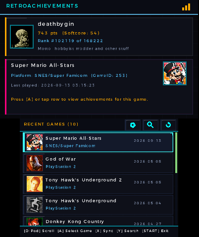
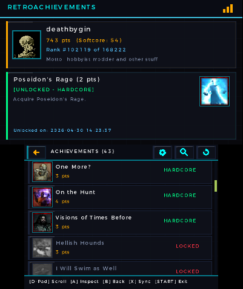
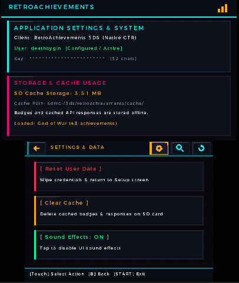

# RetroAchievements for Nintendo 3DS

A vibe-coded graphical frontend homebrew application for the Nintendo 3DS (`.cia` / `.3dsx`) that connects to the official [RetroAchievements](https://retroachievements.org/) Web API.

DISCLAIMER: This application is vibe-coded; use at your own risk and do not distribute this code anywhere that AI-generated code is not allowed.

---

## Screenshots

| Profile & Recent Games | Achievements View | Settings & Data |
| :---: | :---: | :---: |
|  |  |  |

---

## Features

- **Dual-Screen Interface:**
  - **Top Screen:** Displays user profile stats (rank, hardcore/softcore points, avatar, motto) and selected achievement details with live badge art.
  - **Bottom Screen:** Interactive, touch-enabled scrollable lists for recent games, achievement sets, search results, and settings action cards.
- **Game Progress & Achievements Browser:**
  - View full achievement sets for any played or searched game.
  - Distinct hardcore (green) vs. softcore (cyan) unlock status indicators, point values, descriptions, and unlock timestamps.
- **Global Game Search:**
  - Search across all major RetroAchievements console libraries by game title or direct Game ID lookup.
- **On-Screen Software Keyboard:**
  - In-app credential setup using the native Nintendo 3DS Swkbd applet — no manual text file editing required.
- **Hardware DSP UI Sound Effects:**
  - Tactile audio cues for list navigation, item selection, back navigation, toggle actions, success, and errors.
  - Persistent sound toggle in the Settings menu.
- **Asset Caching & Network Optimization:**
  - Background asynchronous image downloader and API worker thread.
  - Persistent on-device SD card caching (`sdmc:/3ds/retroachievements/cache/`) with in-app cache clearing.
- **Bare-Metal 3DS Ready:**
  - Fully compatible with Old 3DS and New 3DS consoles under Luma3DS custom firmware.
  - Packaged as both an installable `.cia` title (with custom banner and icon) and standard `.3dsx` homebrew executable.

---

## Installation

### CIA (Installed to HOME Menu)
1. Copy `RetroAchievements.cia` to your 3DS SD card.
2. Install the `.cia` file using **FBI** (under `SD -> RetroAchievements.cia -> Install CIA`).
3. Launch **RetroAchievements** directly from the Nintendo 3DS HOME Menu.

### 3DSX (Homebrew Launcher)
1. Copy `RetroAchievements.3dsx` and `RetroAchievements.smdh` to `sdmc:/3ds/RetroAchievements/` on your SD card.
2. Launch the app through the **Homebrew Launcher**.

---

## Configuration

On first launch, the app prompts you to enter your credentials using the on-screen touch keyboard.

Alternatively, you can manually place your credentials in `sdmc:/3ds/retroachievements/config.ini`:

```ini
[retroachievements]
username = YOUR_USERNAME
web_api_key = YOUR_WEB_API_KEY
sound_enabled = 1
preferred_screen = 0
```

> **Note:** Obtain your Web API key under **Settings > Keys** on [RetroAchievements.org](https://retroachievements.org/controlpanel.php).

---

## Controls

| Control | Action |
| :--- | :--- |
| **D-Pad Up / Down** | Scroll through achievement / game list |
| **Circle Pad Up / Down** | Smooth list scroll |
| **A** | Select / Inspect achievement / Confirm modal / Retry |
| **B** | Return to previous screen / Cancel modal dialog |
| **X** | Sync profile summary / Open Username keyboard in setup |
| **Y** | Open Global Search / Open API Key keyboard in setup / Reload config on error |
| **START** | Clean exit to HOME Menu or Homebrew Launcher |
| **Touch Screen** | Tap cards, buttons, or drag to scroll lists directly |
